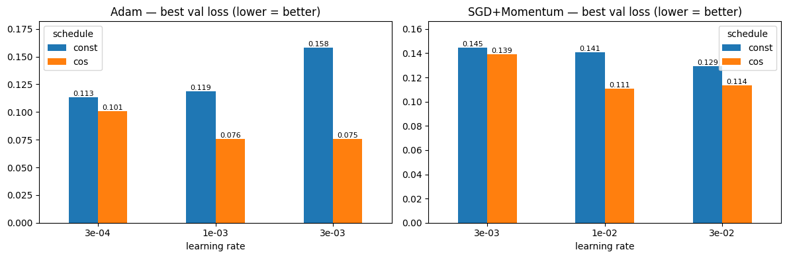
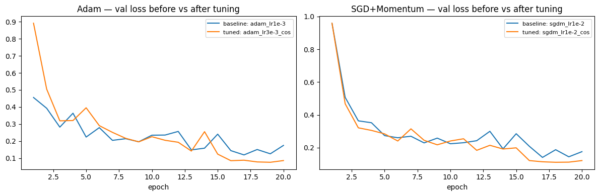
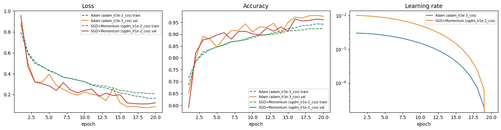
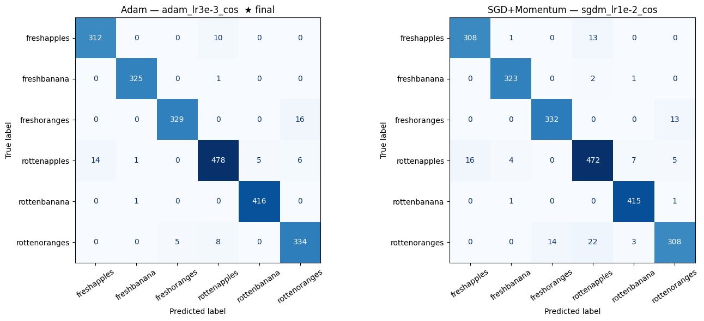

# Automated Produce Quality Inspector

CS461 project — a custom CNN that looks at a photo of an apple, banana or orange and decides whether it is **fresh or rotten**, so people only need to check the fruit the model is unsure about.

กลุ่ม All in · ศุภชัย · สกลวรรธน์ · มาติกา · ณภัทร · ชนะพล

## Results

Clean test set: 2,261 images (6 classes), the test split minus every image with a near-duplicate in train. Each optimizer was tuned over 3 learning rates × constant/cosine schedule (12 runs, same seed). The best setup per optimizer was picked by **validation loss**, and the overall winner, **Adam lr 3e-3 + cosine**, is the model in the web app.

| Metric (clean test) | Target | **Adam lr 3e-3 cos** (final) | Adam lr 1e-3 (baseline) | SGD+M lr 1e-2 cos (tuned) | SGD+M lr 1e-2 (baseline) |
|---|---|---|---|---|---|
| Accuracy | ≥ 90% | **97.0%** | 95.6% | 95.4% | 95.1% |
| Macro F1 | ≥ 0.90 | **0.971** | 0.957 | 0.955 | 0.952 |
| Rotten recall | ≥ 95% | **98.3%** | 98.3% | 97.2% | 97.5% |
| False reject (fresh → rotten) | — | **2.7%** | 3.8% | 2.9% | 3.3% |
| Best val loss | — | **0.075** | 0.119 | 0.111 | 0.141 |

Model: 4 × [Conv → BatchNorm → ReLU → MaxPool] → global average pool → FC + dropout, 422K parameters, ~1 ms per image on a T4 GPU, ~9 min to train 20 epochs.

Data: [Fruits fresh and rotten for classification](https://www.kaggle.com/datasets/sriramr/fruits-fresh-and-rotten-for-classification) (13,599 images). 16.2% of the original test images had a near-duplicate in train, so the split is group-aware and results are also reported on a clean test set.

## Repository

| Folder | Contents |
|---|---|
| [`notebooks/`](notebooks/cs461-final.ipynb) | Training notebook — EDA, duplicate detection, baseline → LR/schedule tuning for Adam vs SGD+Momentum, clean-test evaluation. Runs on Kaggle or Colab GPU. Also on Kaggle: [cs461-final](https://www.kaggle.com/code/supachaisuwanthip/cs461-final) |
| [`results/`](results/) | Notebook outputs: [`09_clean_test_comparison.csv`](results/09_clean_test_comparison.csv), [`05_tuning_sweep.csv`](results/05_tuning_sweep.csv) and charts |
| [`webapp/`](webapp/) | FastAPI app with Grad-CAM, deployed on Cloudflare Workers + Containers — see [`webapp/README.md`](webapp/README.md) |
| [`slides/`](slides/CS461_checkin.pdf) | Check-in presentation |

## Charts

| | |
|---|---|
|  |  |
| Best val loss per learning rate and schedule | Val loss: baseline vs tuned |
|  |  |
| Tuned Adam vs tuned SGD+Momentum | Confusion matrices on clean test (tuned models) |

## Run the web app

```bash
cd webapp
pip install torch torchvision --index-url https://download.pytorch.org/whl/cpu
pip install -r requirements.txt
uvicorn app:app --reload        # http://127.0.0.1:8000

npm install && npm run deploy   # deploy to Cloudflare
```
