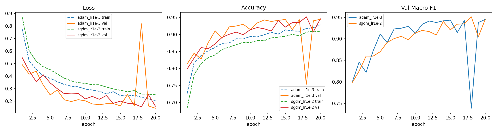
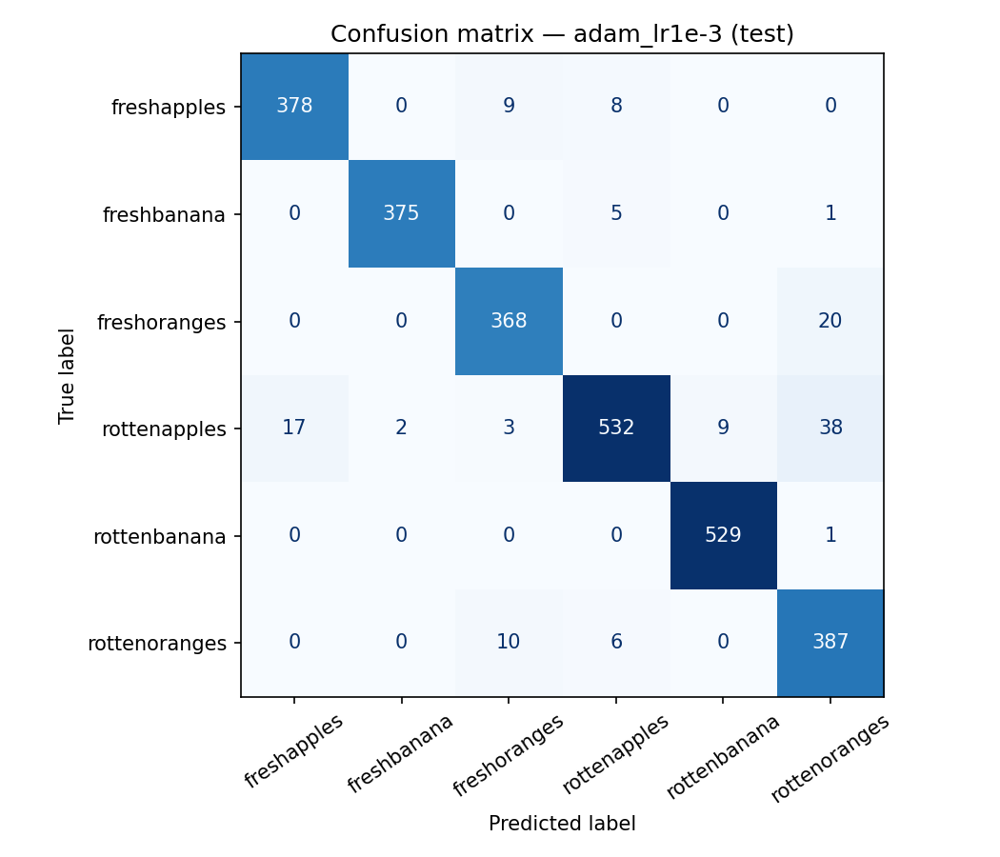

# Automated Produce Quality Inspector

CS461 project — a custom CNN that looks at a photo of an apple, banana or orange and decides whether it is **fresh or rotten**, so people only need to check the fruit the model is unsure about.

กลุ่ม All in · ศุภชัย · สกลวรรธน์ · มาติกา · ณภัทร · ชนะพล

## Results

Test set: 2,698 images (6 classes). Both optimizers met all three targets on the first try; **Adam (lr 1e-3)** was selected by lowest validation loss (not by test score) and is the model in the web app.

| Metric | Target | Adam lr 1e-3 | SGD+Momentum lr 1e-2 |
|---|---|---|---|
| Accuracy | ≥ 90% | **95.2%** | 95.4% |
| Macro F1 | ≥ 0.90 | **0.953** | 0.954 |
| Rotten recall | ≥ 95% | **97.9%** | 98.0% |
| False reject (fresh → rotten) | — | **2.9%** | 3.8% |
| Macro F1 on clean test (no near-duplicates of train) | — | 0.951 | 0.954 |

Model: 4 × [Conv → BatchNorm → ReLU → MaxPool] → global average pool → FC + dropout, 422K parameters, ~1 ms per image on GPU, ~10 min to train 20 epochs.

Data: [Fruits fresh and rotten for classification](https://www.kaggle.com/datasets/sriramr/fruits-fresh-and-rotten-for-classification) (13,599 images). 16.2% of the original test images had a near-duplicate in train, so the split is group-aware and results are also reported on a clean test set.

## Repository

| Folder | Contents |
|---|---|
| [`notebooks/`](notebooks/CS461_checkin_baseline.ipynb) | Training notebook — EDA, duplicate detection, Adam vs SGD+Momentum, evaluation. Runs on Kaggle or Colab GPU. |
| [`results/`](results/) | Notebook outputs: [`results.json`](results/results.json), [`05_comparison.csv`](results/05_comparison.csv), training histories and charts |
| [`webapp/`](webapp/) | FastAPI app with Grad-CAM, deployed on Cloudflare Workers + Containers — see [`webapp/README.md`](webapp/README.md) |
| [`slides/`](slides/CS461_checkin.pdf) | Check-in presentation |

## Charts

| | |
|---|---|
|  |  |
| Loss / accuracy: Adam vs SGD+Momentum | Confusion matrix (best model) |

## Run the web app

```bash
cd webapp
pip install torch torchvision --index-url https://download.pytorch.org/whl/cpu
pip install -r requirements.txt
uvicorn app:app --reload        # http://127.0.0.1:8000

npm install && npm run deploy   # deploy to Cloudflare
```
